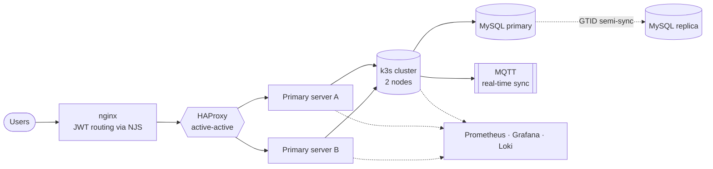

<p align="center">
  <a href="https://github.com/ayush85"></a>
</p>

<p align="center">
  <a href="https://linkedin.com/in/ayushshrestha85"></a>
  <a href="mailto:ayushshrestha8585@gmail.com"></a>
  
  
</p>

---

## `~ $ whoami`

```yaml
name:        Ayush Shrestha
role:        Full Stack & Infrastructure Engineer
location:    Kathmandu, Nepal
education:   B.E. Computer Engineering, Tribhuwan University
currently:   Mentor Friends Pvt. Ltd.
focus:
  - Operating a self-managed multi-node production platform (k3s + Proxmox + LXD)
  - MySQL replication, nginx / HAProxy traffic routing, observability
  - Distributed access control and real-time sync over MQTT
stack:       [TypeScript, React, .NET Core, Node.js, Django, Go, Kubernetes]
```

## `~ $ cat architecture.mmd`

A simplified view of the platform I build and run day to day.



## `~ $ ls ./stack`

<p>
  
  <br/>
  
  <br/>
  
  <br/>
  
</p>

**Also:** Proxmox · LXD · HAProxy · Traefik · WireGuard · Loki · Alloy · k6 · MQTT · Certbot/ACME · Swagger · Jira

## `~ $ git log --career`

```text
* Dec 2024 - now   Mentor Friends Pvt. Ltd.
|                  Full Stack / Infrastructure Developer
|                  k3s + Proxmox + LXD platform, MySQL 8.0 -> 8.4 replication (27GB),
|                  nginx from source with JWT/NJS routing, HAProxy, Prometheus/Grafana/Loki,
|                  k6 load tests, FreeSchemaAccessControl, in-house CI/CD
|
* Jun 2023 - Sep 2024  Urban Nepal Consulting Pvt. Ltd.
|                  Full Stack Developer
|                  Optix SaaS backend modules in Django + PostgreSQL, DigitalOcean Spaces
|
* Nov 2022 - Jun 2023  Logicseed
                   Junior Full Stack Developer / Web Dev Intern
                   HR system (Django), Core PHP + Supabase, Pandas/Selenium scraping
```

## `~ $ ls ./projects`

| Project | What it is | Tech |
| --- | --- | --- |
| **Fatafat** ([API](https://github.com/ayush85/fatafat-backend)) | E-commerce platform: Next.js storefront (private repo) on a Laravel REST API with Sanctum auth, products, cart, orders, reviews and Scribe docs | Next.js, Laravel, MySQL |
| [**Egg Farm Management**](https://egg-farm.aydexis.com) | Management platform for poultry and egg farm operations (live demo; source is private) | TypeScript |
| **Optix** | Small-tools and equipment tracking for construction: custody, jobsite assignment and an append-only ledger (private repo) | Next.js, Hono, tRPC, Drizzle, Postgres |
| [**Menuor**](https://github.com/ayush85/MoodMenu) | Multi-restaurant menu platform with per-restaurant custom domains, automated nginx and Let's Encrypt provisioning | Next.js, Prisma, Docker |
| [**aydexCloud**](https://github.com/ayush85/aydexCloud) | Privacy-focused web analytics: Go event tracker with a Next.js dashboard | Go, Next.js, Prisma |
| **Futsal Booking** | Court booking with customer, owner and admin roles and an approve/reject flow (private repo) | React, Express, Prisma |
| [**FinTrack**](https://github.com/ayush85/FinTrack) | React Native app that parses bank and wallet SMS into categorized spending summaries | React Native |

## `~ $ ./stats.sh`

<p align="center">
  
  
</p>


