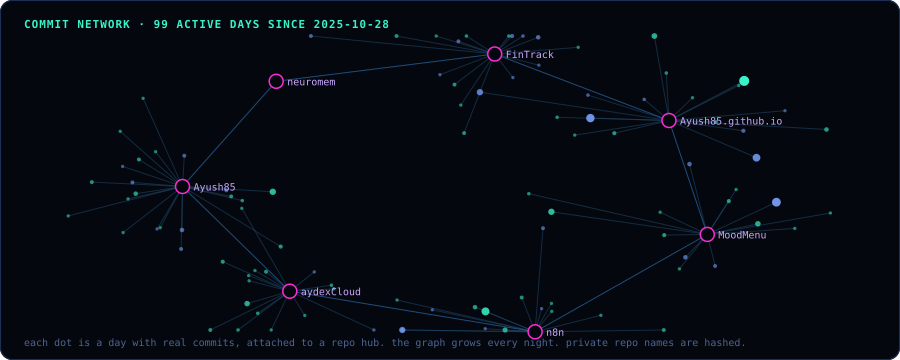

<p align="center">
  
</p>

<p align="center">
  <a href="https://linkedin.com/in/ayushshrestha85"></a>
  <a href="mailto:ayushshrestha8585@gmail.com"></a>
  
  
</p>

---

## `~ $ whoami`

```yaml
name:        Ayush Shrestha
role:        Full Stack & Infrastructure Engineer
location:    Kathmandu, Nepal
education:   B.E. Computer Engineering, Tribhuwan University
currently:   Mentor Friends Pvt. Ltd.
focus:
  - Operating a self-managed multi-node production platform (k3s + Proxmox + LXD)
  - MySQL replication, nginx / HAProxy traffic routing, observability
  - Distributed access control and real-time sync over MQTT
stack:       [TypeScript, React, .NET Core, Node.js, Django, Go, Kubernetes]
```

## `~ $ ls ./stack`

<p>
  
  <br/>
  
  <br/>
  
  <br/>
  
</p>

**Also:** Proxmox · LXD · HAProxy · Traefik · WireGuard · Loki · Alloy · k6 · MQTT · Certbot/ACME · Swagger · Jira

## `~ $ git log --career`

```text
* Dec 2024 - now   Mentor Friends Pvt. Ltd.
|                  Full Stack / Infrastructure Developer
|                  k3s + Proxmox + LXD platform, MySQL 8.0 -> 8.4 replication (27GB),
|                  nginx from source with JWT/NJS routing, HAProxy, Prometheus/Grafana/Loki,
|                  k6 load tests, FreeSchemaAccessControl, in-house CI/CD
|
* Jun 2023 - Sep 2024  Urban Nepal Consulting Pvt. Ltd.
|                  Full Stack Developer
|                  Optix SaaS backend modules in Django + PostgreSQL, DigitalOcean Spaces
|
* Nov 2022 - Jun 2023  Logicseed
                   Junior Full Stack Developer / Web Dev Intern
                   HR system (Django), Core PHP + Supabase, Pandas/Selenium scraping
```

## `~ $ ls -l ./projects`

| Project | Visibility | Stack | Engineering notes |
| --- | --- | --- | --- |
| [**egg-farm**](https://egg-farm.aydexis.com) | `live` | `TypeScript` | Management platform for poultry and egg farm operations (source private) |
| [**menuor**](https://github.com/ayush85/MoodMenu) | `public` | `Next.js` `Prisma` `Docker` | Multi-tenant menus; per-restaurant custom domains with cron-driven nginx vhost + certbot provisioning |
| [**aydexCloud**](https://github.com/ayush85/aydexCloud) | `public` | `Go` `Next.js` `Prisma` `Caddy` | Privacy-first analytics: Go event tracker, Next.js dashboard, Sentry, Compose deploy |
| **futsal** | `private` | `React` `Express` `Prisma` `Postgres` | Role-based booking (customer / owner / admin); slot lock on approve auto-rejects competing requests |
| [**FinTrack**](https://github.com/ayush85/FinTrack) | `public` | `React Native` | On-device SMS parsing into categorized debit/credit summaries |

## `~ $ ./status.sh`

<p align="center">
  
</p>

## `~ $ tail -f telemetry.log`

<p align="center">
  
</p>

## `~ $ ./commit-network`

<p align="center">
  
</p>

## `~ $ ./incident-response`

A shared cluster incident, played one turn at a time through GitHub issues. Keep every service above 70% before any hits 0%.
**[Take a turn](https://github.com/Ayush85/Ayush85/issues/new?template=game.yml)** (a different player has to move next).

<p align="center">
  
</p>

## `~ $ tail -f guestbook.log`

**[Sign the guestbook](https://github.com/Ayush85/Ayush85/issues/new?template=guestbook.yml)** and your line shows up below within a minute.

<p align="center">
  
</p>
